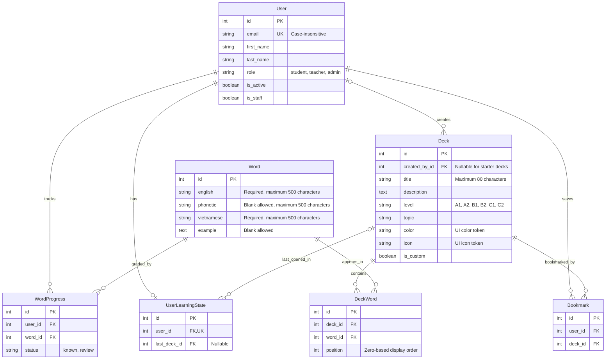

# English Flashcards — proposed data model

Reviewed on 2026-10-23 against the backend and the sibling
`../english-flashcards` frontend. This is a proposed backend schema, not a
diagram of tables already implemented or verified in a running database.

## Findings and recommendation

The backend currently defines one concrete application model, `User`, with
`student`, `teacher`, and `admin` roles. `BaseModel` is abstract and supplies
`created` and `modified` timestamps. The registered application APIs currently
cover authentication and users only.

Add **six models** to persist the frontend's existing vocabulary and learning
features. Suggested organization: `Deck`, `Word`, and `DeckWord` in a vocabulary
app; `Bookmark`, `WordProgress`, and `UserLearningState` in a learning app.

| Model | Status | Purpose and evidence |
| --- | --- | --- |
| `User` | Existing | Reuse the account and role model; no separate student or teacher tables are needed for current features. |
| `Deck` | Add | Stores starter, prepared, and imported sets, including title, description, CEFR level, topic, color, and icon (`Deck` in frontend types). |
| `Word` | Add | Stores English text, phonetics, Vietnamese meaning, and an optional example (`Word` in frontend types). |
| `DeckWord` | Add | Ordered membership between decks and words. `Prepare.tsx` retains source word IDs when creating another set, so a word can belong to several decks. |
| `Bookmark` | Add | A user's saved decks, corresponding to `SavedState.bookmarks` and the bookmark toggle. |
| `WordProgress` | Add | The user's latest `known` or `review` grade for a word. Progress is keyed by word ID, not by deck membership. |
| `UserLearningState` | Add | The user's last opened deck, corresponding to `SavedState.lastDeck`; supports “continue studying.” |

### Design assumptions

These are recommendations for the backend integration, not existing frontend
behavior:

- Persist learning data per authenticated user. The current frontend instead
  shares localStorage data across role changes and allows anonymous students to
  study. Guests can keep local progress; claiming or merging browser data into
  an account needs an explicit integration policy.
- Track a creator for custom decks. Starter decks have no creator and
  `is_custom = false`; custom decks have a creator and `is_custom = true`.
  Creator ownership is attribution, not a visibility rule. The current library
  exposes all available custom and starter decks; this proposal adds no private
  decks, classroom membership, or sharing rules.
- Use integer primary keys, consistent with the existing `User` migration.
  Frontend deck/word IDs are strings, including generated IDs and starter slugs.
  An API adapter must serialize IDs consistently; importing existing browser
  data requires an old-ID-to-new-ID map for memberships, progress, bookmarks,
  and the last deck. Prepared copies of a source word must map to the same row.
- Proposed models inherit `BaseModel`. The ERD omits their repeated `created`
  and `modified` fields for readability. `User` shows relevant domain fields,
  omitting inherited authentication fields and Django/Knox infrastructure tables.

## Mermaid ERD

`User` exists; every other entity below is proposed. `PK` means primary key,
`FK` foreign key, and `UK` an individual unique constraint. Composite unique
constraints are listed below the diagram. `o|` means zero or one, `||` exactly
one, and `o{` zero or many. Nullable foreign keys are explicitly annotated.

## Constraints and relationship behavior

| Model | Proposed constraints and behavior |
| --- | --- |
| `Deck` | Nonblank title, maximum 80 characters; level restricted to A1–C2. Require a creator for custom decks and no creator for starter decks. Protect referenced creators from deletion while their decks exist; deactivate accounts or explicitly reassign/remove their content first. |
| `Word` | Nonblank English and Vietnamese; phonetics and examples may be blank. Do **not** make English globally unique: separate imports intentionally receive independent word IDs and progress, and translations may differ. |
| `DeckWord` | Unique `(deck_id, word_id)` and `(deck_id, position)`; position must be nonnegative. Order by position. Cascade membership deletion when its deck is deleted; protect words still referenced by memberships. |
| `Bookmark` | Unique `(user_id, deck_id)`; cascade when the user or deck is deleted. Removing a bookmark deletes this row only. |
| `WordProgress` | Unique `(user_id, word_id)`; status restricted to `known` or `review`. Upsert the latest grade; absence of a row means unstudied. Cascade when the user or an unreferenced word is deleted. |
| `UserLearningState` | One-to-one with `User`; create lazily. Cascade on user deletion; set `last_deck_id` to null on deck deletion. Opening a deck updates this pointer; it does not save card position or an unfinished session. |

Deck creation should atomically save the deck and its ordered memberships, with
1–1,000 distinct words. The ERD permits zero memberships because a foreign key
cannot enforce a parent's minimum child count; enforce the nonempty-deck and
size rules in the service/API transaction. The frontend saved-state validator
already requires this range.

Prepared sets link existing word rows; importing a new list creates new word
rows. Import deduplication is local to one import and compares normalized,
case-insensitive English text, matching `parseVocabulary`. Validate the current
500 KB file limit, word count, and field lengths before committing an import.
Deleting a deck must not delete shared words or their learning progress.

Use the unique indexes above for membership and progress lookups. Add a
`Deck.level` index for level filtering; add more search indexes only when the
chosen database queries and measured usage justify them.

## Mapping back to the frontend

| Frontend data or workflow | Backend representation |
| --- | --- |
| `Deck.words` | Join through `DeckWord`, ordered by `position`, serialized as nested words. |
| `Deck.custom` | Serialize `Deck.is_custom` as `custom`. |
| Library and topic/level filters | Query decks and related word text; keep `topic` as a string and `level` as a choice field. |
| Teacher preparation | Create a custom deck and link selected starter words; level belongs to the deck, not the word. |
| CSV/TSV/TXT import and export | Parse into decks, words, and memberships; generate CSV from those rows. No separate file table is required. |
| My sets / created tab | For an account-based backend, use decks created by that user plus their bookmarks; the created tab filters by creator. This adapts the current single-browser `custom` flag behavior. |
| `SavedState.bookmarks` | Deck IDs from that user's `Bookmark` rows. |
| `SavedState.progress` | Map word IDs to the user's `WordProgress.status`. |
| `SavedState.lastDeck` | `UserLearningState.last_deck_id`, with the current starter-deck fallback when absent. |
| Learned words and level totals | Count distinct word IDs in the applicable decks and join the user's latest grades. |
| Completed sets | Derive from every member word having status `known`; no persisted completion counter. |
| Current study session | Keep shuffle order, current card, flipped state, and per-session grades in frontend state, as today. |

The backend already has a teacher role, but the frontend currently supports only
student and admin roles and gates preparation, import, bookmarks, and the
progress page behind admin checks. Teacher permissions and account-based
visibility must be specified when implementing the API; this ERD does not
claim that the teacher workflow is already authorized by the application.

## Models not needed yet

- **Separate `Flashcard`:** a word rendered in a deck already supplies both
  sides of the flashcard. `DeckWord` handles membership and ordering.
- **`Topic` or `Level`:** the UI derives topics from deck strings and uses a
  fixed CEFR list. Add a topic table only if managed categories become a feature.
- **`StudySession` / `StudyReview`:** completion summaries currently exist only
  during the active session. Add these if historical attempts, trends, or
  resumable sessions become requirements.
- **Spaced-repetition scheduling:** no due dates or scheduling algorithm exist
  in the current frontend. Add scheduling state only with that feature.
- **Classroom, enrollment, assignment, sharing, and import-job models:** no
  current workflow requires them. Imports run locally and pronunciation uses
  browser speech synthesis, so an audio-asset model is also unnecessary.

## Source references

Paths below are relative to the backend repository unless stated otherwise.
Frontend paths refer to the sibling `../english-flashcards` project.

- Backend: `apps/users/models/user.py`,
  `apps/users/migrations/0001_initial.py`,
  `apps/users/migrations/0002_remove_user_avatar_user_role.py`,
  `apps/core/models.py`, `config/settings/common/installed_apps.py`, and
  `config/urls/api/v1.py`.
- Frontend data contract and persistence: `src/lib/types.ts`,
  `src/lib/storage.ts`, and `src/data/vocabulary.ts`.
- Shared words and imports: `src/app/components/Prepare.tsx`,
  `src/app/components/ImportDialog.tsx`, `src/lib/import.ts`,
  `src/lib/decks/DeckCollection.ts`, and `tests/decks.test.ts`.
- Learning and access: `src/app/components/Study.tsx`,
  `src/app/pages/progress/ProgressPage.tsx`,
  `src/app/workspace/useWorkspace.ts`, `src/app/workspace/Workspace.tsx`,
  `src/app/workspace/WorkspaceContent.tsx`, `src/lib/auth.ts`, and `README.md`.
